# LogiNexus — Freight Intelligence


A freight data engineering and analytics portfolio: a **97.6-million-row** Medallion pipeline, observed Brazilian transport histories, evaluated forecasting baselines, constrained transport optimization, truck-aware routing and a documented API.

**[Review results without starting a server](docs/portfolio_evidence.md)** · **[Open the interactive demo](https://loginexus-dashboard-preview.onrender.com/)** · [Public API](https://loginexus-dashboard-preview.onrender.com/api/docs) · [Delivery checklist](docs/expansion_execution.md)

**Delivery status:** the original 12 portfolio stages and 20 concrete expansion items are delivered for their documented coverage. Four additional requirements remain unmet and have explicit completion criteria and dependencies in the [checklist](docs/expansion_execution.md). Additional sources or commercial requirements do not silently enlarge completed work.

> **Demo hosting:** the dashboard and public API share one free Render service. After 15 minutes without inbound traffic, it sleeps; the next visit normally takes about a minute to wake. Limits and restarts can also affect availability. [Render's free-service policy](https://render.com/docs/free). Screenshots, the static results report, source code, public aggregates and local Docker instructions below do not depend on that service being awake. Free hosting is a demonstration choice, with no permanence or production-uptime guarantee.

The project and dashboard default to **English**, with optional Portuguese controls and core notices. Original source identifiers and exported schemas retain their source language.

## Roadmap progress

- [x] **Original roadmap: 12/12 stages delivered.**
- [x] **Documented expansions: 20/20 delivered for their stated coverage.**
- [x] **Additional requirements closed: 3/7 — X05, X06 and X07.**
- [ ] **X01:** commercial truck-dispatch assurance.
- [ ] **X02:** complete toll/driver-hours operating acceptance.
- [ ] **X03:** independent API hosting and production availability.
- [ ] **X04:** measured results from an actual company operation.

**Latest implemented checkpoint: X02-T07 — declared regime gate in the weekly review.**
Omitted/unknown or collective/exempt regimes keep observed work and coverage, but
receive no standard-profile references or approval. This completes the gate;
it does not verify an actual employment regime. The [marked X02 checkpoints and
remaining acceptance gates](docs/expansion_execution.md#x02-implementation-checkpoints)
remain separate from the four open requirements. These counters must accompany
future progress reports; enhancements within E20 do not invent new completed stages.

## What you can review

| Area | Implemented capability | Evidence and guide |
| --- | --- | --- |
| Data engineering | FAF5 CSV → Bronze Parquet → long-format Silver → analytical Gold; streaming/lazy processing, staged file replacement, ordered orchestration and dry-run plan | [Pipeline and original roadmap](docs/roteiro_original.md), [source structure](freight_intelligence/) |
| Freight analytics | Annual KPIs, growth across irregular years, CAGR, commodity mix, domestic modes, corridor concentration and leading corridors | [Dashboard guide](docs/dashboard.md), [versioned demo aggregates](deployment/preview_data/) |
| Forecast evaluation | Persistence, linear and CAGR baselines; expanding-window validation and reserved tests for rail, air, port handling and Transpetro oil movements; vintage cutoffs and units kept separate | [Evaluation methodology](docs/temporal_evaluation.md), [all candidate scores](docs/portfolio_evidence.md#forecast-results-including-competing-baselines), [port/oil vintage reports](docs/brazil_modal_forecasts.md) |
| Brazilian railway | ANTT movements, 2006–2025; monthly/annual series, commodities, state pairs and concessionaires; reserved forecast evaluation | [Railway coverage and units](docs/brasil.md) |
| Brazilian road | 28 observed months, July 2024–October 2026, split by own-account flag; 775 paired 2025 state flows with independent margin reconciliation. Archived yearbook months and sixteen RGI pairs remain separate | [Road history](docs/brazil_road_history.md), [state pairs](docs/brazil_road_od.md), [archived regional flows](docs/brazil_road.md) |
| Brazilian water | 43 annual/regional references, 62 original port-handling months, 21 regional cabotage shares and 510 observed OD pairs; original exports preserved | [ANTAQ sources](docs/brazil_water.md), [monthly history](docs/brazil_water_history.md) |
| Inland-waterway transport | 62 monthly totals and three navigation components, January 2021–February 2026; 117 source cargo categories in 2025, preserving eight unavailable quantities and 46 explicit zeros | [Original inland transport exports and coverage](docs/brazil_inland.md) |
| Brazilian air | 624 monthly aggregates, 2000–2025; 55,559 monthly airport pairs, 2023–2025; 1,102 source airport codes; paid/free/mail separated; six separately evaluated forecast targets | [ANAC preparation and limitations](docs/brazil_air.md) |
| Brazilian port pairs | 510 observed cabotage links; all 98 origins and 71 destinations in the reviewed 2025 table, with original numeric tonnes and archived filters | [Port-pair data and original exports](docs/brazil_water_ports.md) |
| Brazilian pipelines | 600 gas operator/direction/month records, 2021–2025; signed volumes, duplicate policy and missing-cell point/date diagnostics | [ANP gas history and quality](docs/brazil_gas_history.md) |
| Five-mode atlas | 145 annual indicators with separate units, statistical populations, source links and provenance | [Indicator contracts](docs/brazil_modes.md) |
| Transport optimization | Minimum-cost allocation, capacities, supply/demand balance, transshipment and infeasibility detection | [Solver and exported results](docs/transport_optimization.md) |
| Scenario planner | Bounded editable networks, JSON import, separate simulation submission, reference/candidate comparison and portable downloads | [Planner walkthrough](docs/scenario_planner.md), [synthetic input example](docs/examples/transport_scenario.json) |
| Geographic routing | Distinct OSRM car-reference and Valhalla truck engines; explicit dimensions, weight, axles and hazardous cargo; map, maneuvers and GeoJSON | [Truck profiles and restrictions](docs/truck_routing.md), [saved truck geometry](deployment/route_examples/sao_paulo_campinas_truck.geojson) |
| Trip cost and breaks | Dated Autoban commercial-per-axle tolls for continuous SP-330/SP-348 km 20–100; selected daytime duty limits, loading/waiting as work, pauses and explicit unsupported cases; complete X02 compliance remains open | [Scope, example and API](docs/trip_planning.md) |
| Seven-day duty review | Explicit declared histories, daily/combined weekly rest checks, seventh-workday flags, missing-data handling, dated policy, chart and bounded stateless API; no dispatch certification | [Rules, examples and API](docs/weekly_duty.md) |
| Night-work accounting | Exact 22:00–05:00 overlap, shift/weekly references and separate conditional extension sensitivity, real time preserved, meals/rest excluded, regime review and portable examples | [Calculation and portable evidence](docs/weekly_duty.md#night-work-real-minutes-and-reduced-hour-accounting) |
| Read-only API | Documented indicators, histories, forecasts, quality diagnostics and saved allocations; filters, pagination, optional key/user permissions; hosted public snapshots isolated from private plans | [Endpoint reference](docs/api.md), [authentication and roles](docs/api_authentication.md) |
| Delivery and recovery | Windows/Linux CI, pinned container runtimes, source/data hashes, memory regression checks, exact-tested-commit deployment and recovery archives | [CI workflow](.github/workflows/ci_pipeline.yml), [deployment](docs/publicacao_continua.md), [recovery](docs/recovery.md) |
| Source refresh | Scheduled bounded ANP 2021–2025 (60 monthly reports), ANTT PDF and streaming ANAC CSV revision audits; changed sources quarantined for review rather than automatically published | [Audit policy](docs/source_refresh.md) |

These are workspaces within one application and analytical package. They do not require separate hosted dashboards.

**Road OD expansion:** [775 reviewed 2025 state pairs](docs/brazil_road_od.md), including EX/exterior, reconcile exactly by origin and destination to **1,368,627,704 tonnes**. [Download the complete CSV](deployment/brazil_road/state_od.csv) or use the filtered public API at `/api/brazil/road-state-pairs`. These are reported movements, not truck itineraries.

**Water history expansion:** [62 original monthly port-handling observations](docs/brazil_water_history.md), January 2021–February 2026. Five complete years, explicit partial 2026, filtered CSV/API and annual rounding reconciliation.

**Inland-waterway transport expansion:** [62 months with three navigation components and 117 cargo categories](docs/brazil_inland.md). Source totals reconcile independently; eight dash quantities remain null and 46 explicit zeros stay zero. Transport and port handling remain separate.

## Screenshots

These English-interface captures were taken on 2026-11-18 and 2026-11-19 from the local hosted-app entry point and the versioned public snapshots. They show the actual application, including the reconciled 510-link cabotage view. They remain visible on GitHub while Render sleeps. Open the sections below for additional workspaces.

**Freight analytics — FAF scenarios, units and annual indicators**

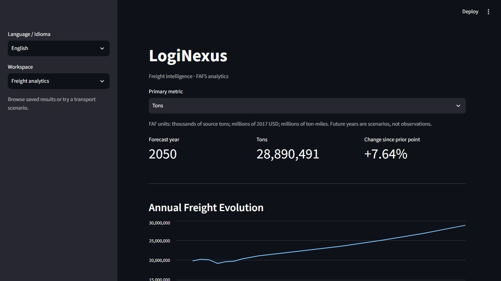

**Transport scenario planner — solved synthetic example, allocation and balance checks**


<details>
<summary>Inland transport, water history, road OD, road history, air cargo, gas history, cabotage OD, water regions and truck routing — ten more screens</summary>

**Road history — July–December 2024, explicitly 6/12 observed months.** Separate N/S own-account categories and document counts. The selector also provides complete 2025 and partial January–October 2026; source editions remain separate.


**State road OD — 775 reported pairs and 1,368,627,704 tonnes for 2025.** All 28 origin and destination margins reconcile exactly, including EX/exterior. The chart shows the 20 largest pairs; all observations remain available in the table and CSV.

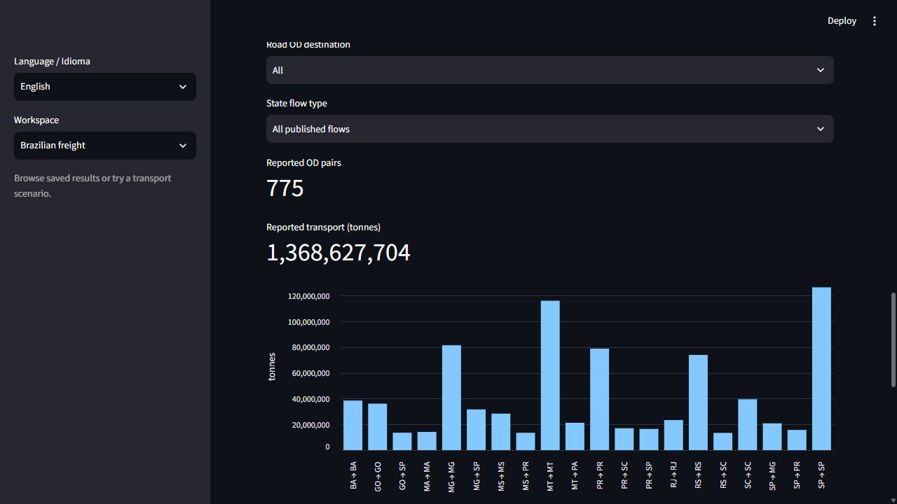

**Port handling history — 62 original monthly observations, January 2021–February 2026.** Five complete calendar years; 2026 explicitly has only two observed months. Values cover handling events across both directions and all navigation categories, with original numeric precision retained.

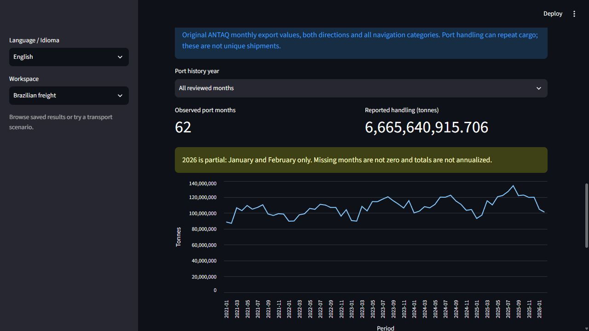

**Inland-waterway transport — 62 monthly totals with three navigation components.** Includes international shipping and cabotage using inland waterways; five complete years and partial 2026. Separate from port handling and operational routing.

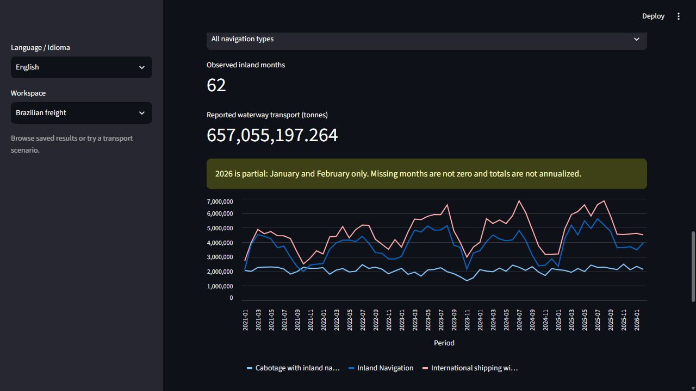

**Inland cargo — 117 original source categories for 2025.** Eight quantities shown as dash remain unavailable; 46 explicit numeric zeros remain zero. Shares retain the full source denominator after filtering.

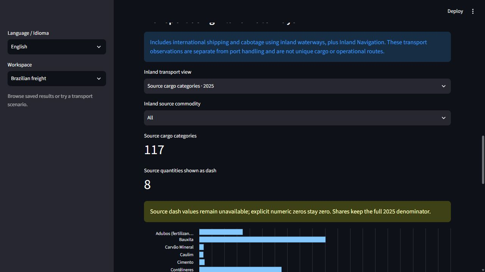

**Air cargo — reported domestic monthly paid-cargo subtotals for 2025, with missing-field disclosure.** Stages can repeat a consignment; the chart is not a complete shipment census.

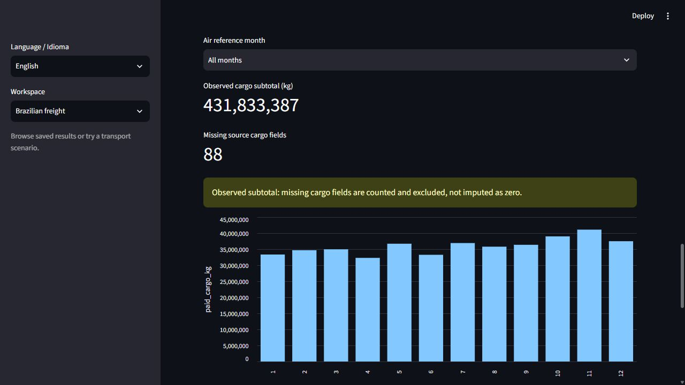

**Gas history — reported delivery-point subtotals for 2022, five operators and 15,109 missing daily source cells.** Missing reports remain missing; these are not production or unique national supply figures. The selector supports 2021–2025.


**Paired regional cabotage — four reported links originating in Nordeste, 2025.** Their 11.35% share retains the full panel denominator; no port itineraries or tonnes are inferred.

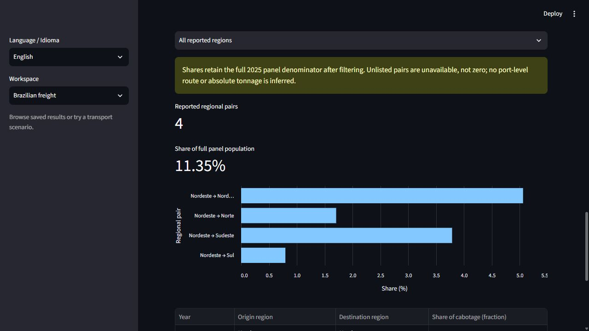

**Observed cabotage OD — 510 links covering all 98 origins and 71 destinations in the reviewed 2025 table.** Original volumes reconcile independently by origin and destination to 222,975,436.378 tonnes. Includes offshore/source categories; these are transport events, not unique cargo or navigable itineraries.


**Saved Valhalla truck route — São Paulo–Campinas.** Original reviewed geometry, displayed without a new routing request. Map restrictions and the saved vehicle profile do not certify current dispatch conditions.


</details>

<details>
<summary>Railway workspace — earlier capture using the optional Portuguese interface</summary>

The railway view includes observed history, monthly movements, commodities and reserved forecast evaluation. This earlier screenshot demonstrates the optional translation; English is the default.

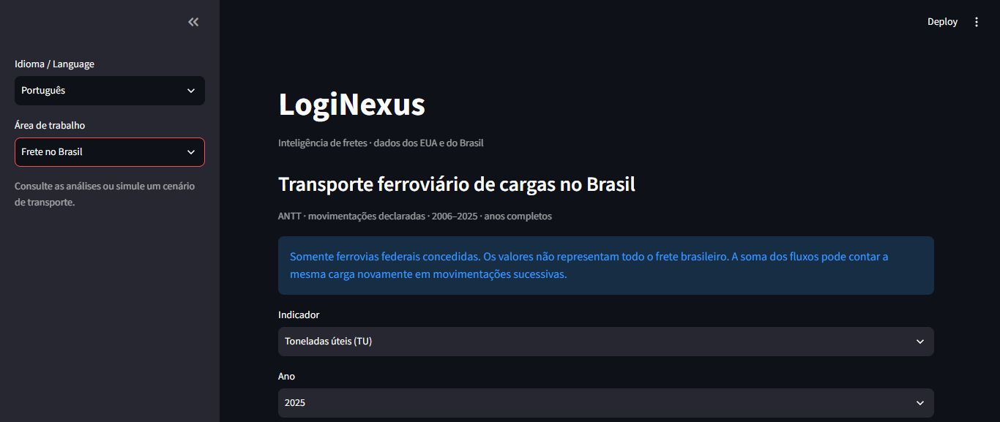

</details>

## Results and engineering decisions

- **Scale:** the full local run completed on 2026-11-12 with **2,503,352 Bronze** and **97,630,728 Silver** rows. Domestic mode analytics use the source's `dms_mode` field. The large raw/Silver layers are not committed to Git.
- **Observed-history forecasting:** ANTT railway evaluation reserves 2023–2025, with validation-selected test WAPE of **4.75% TU / 1.61% TKU**. ANAC paid-cargo selected-model WAPE is **21.96% domestic / 7.32% international**, and both selected models lose to persistence on the reserved test. Four additional free-cargo/mail targets are evaluated separately, with every competing score disclosed. All candidates are shown in the [static report](docs/portfolio_evidence.md); no reselection on test results or accuracy guarantee is claimed.
- **Source quality:** 33 blank gas cells in 2025 are traced to points/dates and remain missing. Road monthly labels reconcile to **1,368,699,651 tonnes**, while the separate regional denominator retains its own unresolved source scope. Water monthly displayed values sum to **1,402,731,832 tonnes**, one tonne below that panel edition's annual headline; no month receives an invented adjustment.
- **Hosting memory:** after a real 512 MiB memory incident, corridor loading was bounded before collection and solver imports deferred. The 2026-11-18 CI revision passed a six-session/18-render check with **249.5 MiB sampled peak** and no OOM events. This is measured test behavior, not an unlimited-concurrency claim. [Incident and correction](docs/memory_incident.md).
- **Validation:** revision [`2e3b383`](https://github.com/DiegoTDDD/freight-intelligence/commit/2e3b383cb7b669524aea3bdc2c4126daa935606f) passed all five [CI checks](https://github.com/DiegoTDDD/freight-intelligence/actions/runs/44393092735), including **387 lightweight tests on Windows and Linux**, API containers and the hosted image. Local real-data tests add coverage where the large dataset exists. Test counts are dated evidence, not a promise that every future revision has the same count.

The [static evidence report](docs/portfolio_evidence.md) is generated from validated committed snapshots. CI checks it for drift, so reviewing results does not require opening Render or processing the large dataset.

### Additional air forecast targets — visible without the live demo

Six separate ANAC targets are evaluated: paid cargo, free cargo and mail, each
domestic/international. The four added targets use sixteen annual observations
in kg (2010–2025), validation through 2022 and a reserved 2023–2025 test.

| Added target | Validation-selected baseline | Reserved-test WAPE |
| --- | --- | --- |
| Domestic free cargo | Persistence | 31.35% |
| International free cargo | Persistence | 28.41% |
| Domestic mail | CAGR | 18.67% |
| International mail | Persistence | 26.60% |

Three selected baselines lose to a competitor on the reserved test; selection
is never repeated on those results. [All candidate scores](docs/portfolio_evidence.md#forecast-results-including-competing-baselines)
and the [portable evaluation ZIP](deployment/brazil_air/forecast.zip) remain
available while Render sleeps. In the dashboard choose **Brazilian freight →
All five modes → air → Forecast evaluation → Air cargo measure**. The API supports
[scores, predictions and forecasts by measure](docs/brazil_air.md#use-and-rebuild).

### Trip cost and breaks — dated planning example

Select **Trip cost and breaks** in the same dashboard. For a loaded two-axle
truck travelling continuously from km 20 to km 100 of SP-330, the reviewed-date
estimate is **BRL 57.60**. A declared 120-minute drive, 30-minute loading,
60-minute waiting and 30-minute delivery totals **240 work minutes** and
**300 elapsed minutes** with the simulated one-hour meal.

This is a planning simulation using tariffs reviewed on 2026-11-20. It does not
automatically price the map route or certify driver/legal compliance. Out-of-date
price requests return `null`; waiting is counted as work. [Full example and rules](docs/trip_planning.md)
and [portable JSON](docs/examples/trip_planning.json) are available while the demo sleeps.


The screenshot shows selected planning limits; complete operating compliance
remains an open X02 requirement.

### Declared seven-day duty review

Inside **Trip cost and breaks**, choose **Seven-day duty review**. The balanced
synthetic week displays **168 covered hours and 44 declared work hours** for
2026-11-09. Other examples flag a short daily rest, seven workdays and incomplete
history. Unknown history is not silently filled with rest or zero work.

[Full policy, dates and API](docs/weekly_duty.md) · [Portable example report](docs/examples/weekly_duty_report.json).
This expands the simulator; complete operational X02 acceptance remains open.

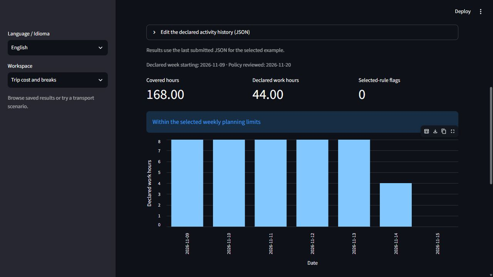

### Night-work accounting

Choose **Reduced-hour reference exceeded** in the seven-day review. The synthetic
22:00–07:00 shift excludes a full meal: **8 real work hours**, **6 night-window
hours** and **8.86 base-window equivalent hours**. It exceeds the selected
eight-hour reference despite not exceeding eight real work hours. Exact fractions
and shift/weekly comparisons are retained in JSON; display rounding never decides
the result. The original **Night shift and extension** example remains available.
Work after 05:00 still requests extension review; real driving/rest durations
are preserved and no wages or dispatch approval are calculated.

[Policy and calculation](docs/weekly_duty.md#night-work-real-minutes-and-reduced-hour-accounting) ·
[Portable above-reference example](docs/examples/night_limit_report.json).


**Conditional continuation:** choose **Extension changes the comparison**. The
22:00–06:01 example has **61 observed continuation work minutes** after 05:00.
Its base equivalent is **7.87 hours**; if reduced-hour treatment also applies to
that continuation, the equivalent would be **8.02 hours**. The two comparisons
remain separate: the base result is not replaced, conditional excess requests
review, and actual employment-regime applicability is not decided.
[Calculation and boundaries](docs/weekly_duty.md#conditional-night-extension) ·
[Portable report](docs/examples/night_extension_report.json).

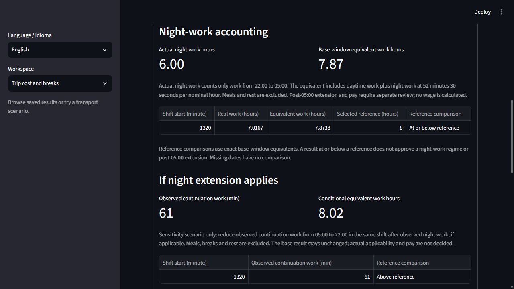

## Run the complete demo locally

With Docker installed, from the repository root:

```bash
docker build -f deployment/Dockerfile.dashboard -t loginexus-dashboard:local .
docker run --rm -p 127.0.0.1:8502:8501 loginexus-dashboard:local
```

Open [http://127.0.0.1:8502/](http://127.0.0.1:8502/). The same application and bundled public aggregates run locally. You do **not** need the raw FAF download, a Render account, API credentials or a full pipeline run to review the analytics, saved reports and saved route. New route requests and basemap tiles require internet access and provider availability; private configured authentication can be tested separately.

For a source installation, use Python 3.13:

```bash
python -m pip install -e ".[app,dev]"
python -m streamlit run dashboards/app.py --server.address 127.0.0.1 --server.port 8501
```

The source launcher normally reads locally generated FAF outputs. Use the Docker demo above for the prepackaged public snapshot. Windows users with the configured project environment can also use [Abrir LogiNexus.cmd](Abrir%20LogiNexus.cmd); [startup guide](docs/dashboard.md).

## Architecture

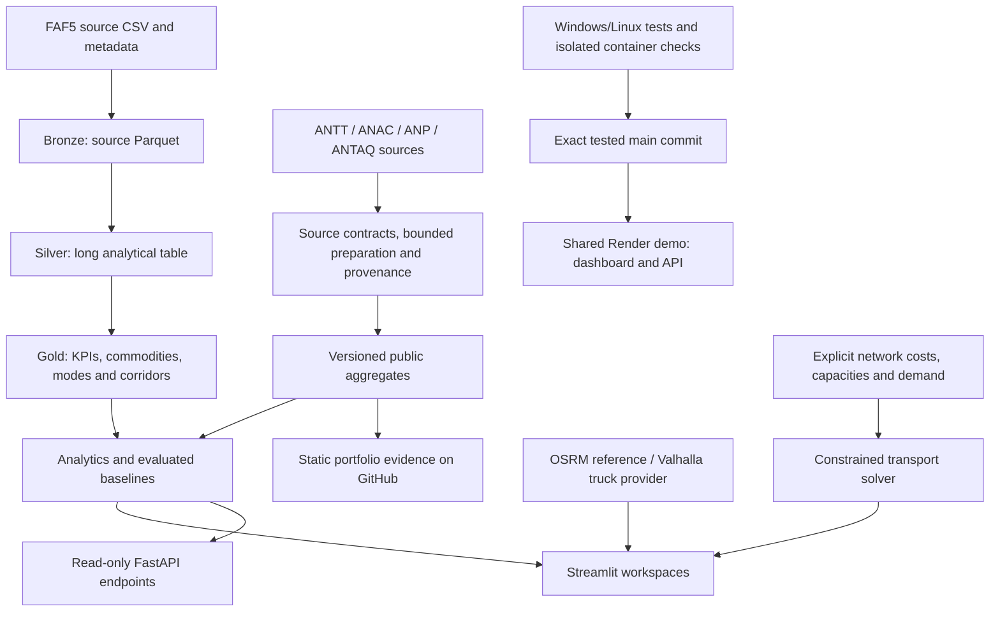

The public host reads compact public snapshots. It does not rebuild the ~100-million-row pipeline on startup, run private saved plans or silently fall back to a car route if truck routing fails. The source package, snapshots, tests and recovery archives can be moved to another host.

**Stack:** Python 3.13, Polars, Parquet/PyArrow, DuckDB, NumPy/SciPy, pandas, scikit-learn, Streamlit, FastAPI, Docker, pytest, Ruff and GitHub Actions. Hosted runtime versions are pinned; [dependency policy](docs/runtime_dependencies.md).

## Reproduce individual components

| Task | Command | Requirement |
| --- | --- | --- |
| Lightweight tests | `python -m pytest tests --ignore=tests/test_faf5.py -q` | Installed app/development dependencies; no large FAF data |
| Code quality | `python -m ruff check .` | Development dependencies |
| Rebuild static portfolio report | `python scripts/build_portfolio_evidence.py` | Committed public snapshots; no network |
| Check portfolio report against data | `python scripts/build_portfolio_evidence.py --check` | Same; fails if the generated report is stale |
| Preview pipeline decisions | `python -m freight_intelligence.pipeline --plan --skip-existing` | Read-only plan; runs no pipeline step |
| Solve the synthetic network | `python -m freight_intelligence.optimization.transport --scenario docs/examples/transport_scenario.json` | Writes scenario results; no FAF pipeline |
| Serve the local API | `python -m uvicorn freight_intelligence.api.app:app --host 127.0.0.1 --port 8000` | Local saved outputs; install `.[api,dev]` |
| Build a committed-revision recovery ZIP | `python scripts/package_recovery.py --output recovery-package` | Git; validates bundled data hashes |

Public API examples:

```text
GET /api/brazil/air-freight?view=pairs&year=2025&limit=10
GET /api/brazil/gas-movements?year=2024&include_diagnostics=true&diagnostics_limit=10
GET /api/brazil/water-freight?dataset=port_monthly&year=2025
GET /api/brazil/water-pairs?origin_region=Norte
GET /api/brazil/modal-forecasts?mode=water&view=scores&phase=test
GET /api/brazil/road-monthly
```

The hosted prefix is `/api`; a separately launched local API uses the endpoint paths without that prefix. Shared-host sleep affects both the public dashboard and these requests. [Full API contracts](docs/api.md).

### Large FAF pipeline

The FAF5.5.1 high/low forecast input comes from the US Bureau of Transportation Statistics / Oak Ridge National Laboratory. Place `FAF5.5.1_HiLoForecasts.csv` and `FAF5_metadata.xlsx` in `data/raw/faf5/forecast/`.

```bash
python -m freight_intelligence.pipeline
```

This explicitly rebuilds Bronze, Silver and Gold and processes approximately 100 million Silver rows. It is separate from the small demo. `--skip-existing` reuses steps only when all outputs exist and upstream steps were not rebuilt; it does not prove file validity or source freshness. The separate [heavy how-to workflow](.github/workflows/howto-check.yml) fails on pipeline errors and preserves logs. The default lightweight CI does not download or rebuild this dataset.

## Data interpretation and remaining work

Port and Transpetro oil/product baselines now evaluate the reviewed rounded
2010–2024 histories, reserving 2022–2024. Selected-model test WAPE is **2.10%**
for port handling and **16.91%** for oil/product movements. Competing baselines
score better on the reserved test and remain visible. The 2025–2027 outputs are
**vintage estimates with a 2024 observation cutoff**, not current observed data;
see [methodology, units and source-edition limits](docs/brazil_modal_forecasts.md).

- FAF includes estimates and future scenarios. Agreement with held-out FAF scenario points is not evidence of future observed-demand accuracy.
- Brazilian series use different populations and units. Airport stages, gas-point transfers, railway movements and port handling may repeat the same physical cargo; they are not comparable national modal shares.
- Truck costing applies available mapped restrictions, not verified current dispatch conditions. Toll pricing, driver-hours compliance, operational certification and provider SLA are not implemented.
- Optimization examples use explicit **synthetic** demand/cost inputs. Scenario cost differences are not measured savings at a real company.
- The expanded roadmap is **still open**: extend water OD to other navigation populations and years, extend road and gas histories, verify additional rail/pipeline coverage, evaluate more adequate historical series, and validate the solver with real operating inputs and outcomes. The reviewed 2025 cabotage table now has complete origin coverage with original absolute tonnes. Availability of source records and business data constrains further claims.

See the [current expansion ledger](docs/expansion_execution.md) for concrete deliveries and dependencies, [current status](docs/status.md) for verification context, and the [recovered original roadmap](docs/roteiro_original.md) as historical planning evidence.

No paid services have been purchased. CI recovery artifacts have limited retention; save an independent copy using the [recovery instructions](docs/recovery.md). The demo can be rebuilt from source and public aggregates; interactive session edits must be exported and are not a persistent customer database.
