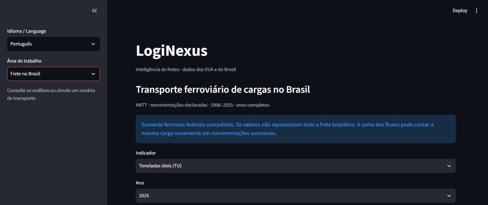
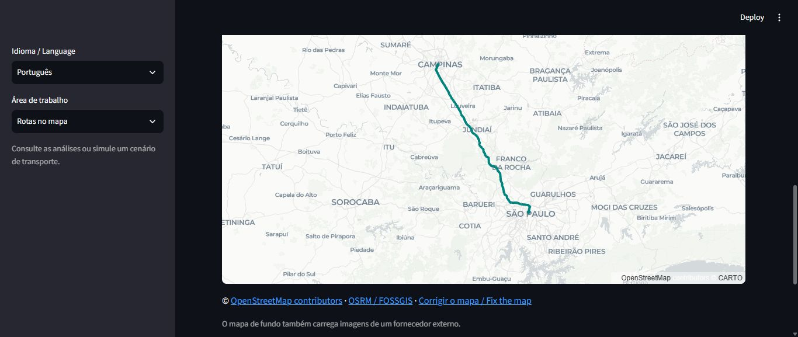

# LogiNexus — Freight Intelligence


End-to-end freight intelligence platform for analyzing and forecasting freight flows using large-scale transportation data.

**[Open the live dashboard](https://loginexus-dashboard-preview.onrender.com/)** ·
[Roadmap and delivery (Portuguese)](docs/plano_finalizacao.md) · [Brazilian data](docs/brasil.md) ·
[Real-road routes](docs/rotas_reais.md) · [Recovery (Portuguese)](docs/recovery.md)

Continuous deployment is verified: after the checks pass, GitHub deploys the exact
tested revision to Render. See [deployment and recovery](docs/publicacao_continua.md).

LogiNexus combines large-scale data engineering, freight analytics, forecasting
evaluation and transport optimization. **The project and dashboard default to English;
Portuguese is an optional interface translation.** The US FAF data includes estimates
and scenarios; the Brazilian workspace uses railway movements reported to ANTT for
2006–2025. Sources and units stay separate. The demo also queries real OpenStreetMap
road routes, using a reference car profile with explicit limitations for truck use.

### Try the demo without processing the large dataset

The dashboard image includes small public aggregates, the Brazilian historical
evaluation and a saved geographic route. From the repository root, with Docker:

```text
docker build -f deployment/Dockerfile.dashboard -t loginexus-dashboard:local .
docker run --rm -p 127.0.0.1:8502:8501 loginexus-dashboard:local
```

Open `http://127.0.0.1:8502/`. Using this demo does not require downloading the raw
dataset or running the 97.6-million-row pipeline. New route requests and the basemap
require internet access. Free hosting may take time to wake after inactivity.

### Verifiable results

- Real pipeline: 2,503,352 Bronze rows and 97,630,728 Silver rows; the full local run
  completed on 2026-11-12. Domestic mode indicators use `dms_mode`.
- Brazil: 20 complete years of ANTT reports with source hashes; 2023–2025 reserved
  for testing. Validation-selected model test WAPE: 4.75% TU and 1.61% TKU.
- Routes: real GeoJSON geometry, source and retrieval date; separate scenario
  calculations use explicit costs and restrictions. No measured savings are claimed.
- Validation: 320 integration tests passed, including real-data checks, plus six
  deployment tests. See [delivery evidence](docs/plano_finalizacao.md).

Forecasts are estimates, not guarantees. Brazilian data covers federally conceded
railways, not every mode. Car-reference routes do not certify truck access.
The snapshot can be recovered and rebuilt independently of the current host.





## Architecture

The project follows a Medallion Architecture:

```text
FAF5 Dataset
     │
     ▼
  INGESTION
     │
     ▼
   BRONZE
Raw structured data in Parquet
     │
     ▼
   SILVER
Long-format analytical dataset
     │
     ▼
    GOLD
Business-ready analytical datasets
     │
     ├── Annual KPIs
     ├── Commodity Mix
     ├── Mode Mix
     └── Top Freight Corridors
     │
     ▼
Analytics / ML / Optimization
```

## Data Source

The project uses the Freight Analysis Framework (FAF5) developed by the U.S. Bureau of Transportation Statistics (BTS) and Oak Ridge National Laboratory (ORNL).

The current pipeline processes the FAF5.5.1 high/low freight forecast dataset.

## Technology Stack

- Python 3.13
- Polars
- Pandas
- PyArrow
- DuckDB
- NumPy
- Scikit-learn
- Plotly
- Pytest

## Pipeline

### Bronze

The ingestion layer converts the original FAF5 CSV dataset into Parquet.

```text
data/raw/faf5/
        ↓
data/bronze/faf5/faf5_forecasts.parquet
```

Dataset:

- 2,503,352 records
- 82 columns

### Silver

The transformation layer converts the wide FAF5 dataset into a long analytical format.

```text
data/bronze/faf5/
        ↓
data/silver/faf5/faf5_long.parquet
```

Dataset:

- 97,630,728 records
- 13 columns

Main analytical dimensions include:

- Origin
- Destination
- Freight mode
- Commodity
- Trade type
- Distance band
- Year
- Metric type

### Gold

The analytics layer produces business-ready datasets:

```text
data/gold/faf5/

├── annual_kpis.parquet
├── annual_growth.parquet
├── annual_cagr.parquet
├── commodity_mix.parquet
├── commodity_lookup.parquet
├── commodity_growth.parquet
├── commodity_share_change.parquet
├── mode_mix.parquet
├── top_corridors.parquet
├── corridor_summary.parquet
└── corridor_concentration.parquet
```

These datasets support freight-flow analysis, forecasting, visualization and optimization.

## Running the Pipeline

Place the FAF5.5.1 source files in the data/raw/faf5/forecast/ directory:

- FAF5.5.1_HiLoForecasts.csv
- FAF5_metadata.xlsx

The default command rebuilds all layers, including Bronze and Silver. This processes about 100 million Silver rows. To reuse generated outputs, pass `--skip-existing`; a step is skipped only when all of its outputs exist and none of its upstream dependencies was rebuilt. File timestamps and source changes are not checked, so use the default rebuild after updating the source data.

Run the complete pipeline from the project root:

    python -m freight_intelligence.pipeline

Reuse existing outputs when the source data has not changed:

    python -m freight_intelligence.pipeline --skip-existing

Launch the dashboard after generating the datasets:

    python -m streamlit run dashboards/app.py --server.address 127.0.0.1 --server.port 8501

The sidebar switches between existing freight analytics, saved scenario extrapolations and transport plans. See [the dashboard guide](docs/dashboard.md) for filters, downloads, result validation and local access.

The [Scenario planner](docs/scenario_planner.md) also lets you edit a small transport network and simulate it on explicit submission. Results stay in session memory and can be downloaded without replacing any saved plan.

Import your own scenario JSON or reuse `scenario.json` from a downloaded bundle. Loading validates the input and fills the editors; simulation requires a separate submission.

Capture a solved scenario as a reference to compare costs and link flows against alternatives with matching units and demand. The comparison bundle preserves both inputs and solutions without replacing saved plans.

Install application dependencies with:

    python -m pip install -e ".[app]"

## Continuous Integration

The Ubuntu job also builds a verified source/data recovery ZIP and SHA-256 checksum
for the committed revision. GitHub retains this downloadable artifact for 30 days;
save an independent copy for longer retention. See [recovery instructions](docs/recovery.md).

The hosted-dashboard job separately builds `deployment/Dockerfile.dashboard` and
checks all 59 runtime pins, the bundled snapshot hashes, and the analytics,
extrapolation and temporal-evaluation views in a read-only, network-isolated
512 MiB container. Run the same check locally after building the image:

    python scripts/check_dashboard_container.py --image loginexus-dashboard:ci

GitHub Actions runs the lightweight tests on every push and pull request:

    python -m pytest tests --ignore=tests/test_faf5.py -q

These cover configuration, pipeline orchestration, commodity lookup under Windows cp1252, annual scenario extrapolation, transport optimization and read-only API queries with temporary fixtures. `tests/test_faf5.py` validates the full FAF5 dataset (~100M rows), which is generated locally and is not stored in the repository, so it only runs where that data exists. The separate heavy `howto-check.yml` workflow builds all layers, stops on pipeline errors, and preserves diagnostic logs for seven days.

## Annual Scenario Baselines

Run the first forecasting baseline independently of the heavy pipeline:

    python -m freight_intelligence.ml.annual_forecast --end-year 2055

This reads only the small `annual_kpis.parquet` Gold table. For each metric it compares persistence, linear trend, and annualized endpoint CAGR against the final three available scenario points, chooses the lowest MAE, and refits that baseline on the complete input. Calendar-year gaps are respected. Results and provenance are written to the ignored `models/faf5/annual/` directory; existing Gold data is preserved.

FAF5 already includes projections through 2050. Outputs are **scenario extrapolations**, and validation measures agreement with held-out FAF values. It does not establish accuracy against future observed demand. See [the forecasting notes](docs/annual_forecast.md) for outputs, assumptions, and limitations.

## Temporal Baseline Evaluation

Compare the baselines with expanding-window validation and a reserved final test, independently of the current forecast outputs:

    python -m freight_intelligence.ml.temporal_evaluation

See [temporal evaluation](docs/temporal_evaluation.md) for split rules, calendar horizons and the interpretation of FAF scenario test values.

Saved reports are available in the dashboard's **Temporal evaluation** workspace and through `/temporal-evaluation` and `/temporal-evaluation/predictions` in the API. These views verify report consistency and source provenance without running evaluation.

## Transport Scenario Optimization

Solve a supplied network with explicit costs, capacities, supply and demand:

    python -m freight_intelligence.optimization.transport --scenario docs/examples/transport_scenario.json

The bundled example is synthetic. The optimizer preserves flow balance and capacities, supports transshipment, and rejects infeasible scenarios. It writes allocation, node checks and provenance to `artifacts/optimization/transport/`, independently of all FAF layers. See [the optimization guide](docs/transport_optimization.md) for the input contract and limits.

## Local API

Serve the existing annual Gold indicators, optional saved scenario extrapolations and transport allocations:

    python -m pip install -e ".[api,dev]"
    python -m uvicorn freight_intelligence.api.app:app --host 127.0.0.1 --port 8000

Open `http://127.0.0.1:8000/docs` for interactive documentation. The API only reads saved outputs; it never triggers the pipeline or solver. `/transport-plan` supports filters and pagination, and `/transport-plan/nodes` exposes balance checks. See [API endpoints and behavior](docs/api.md). Optional [API-key authentication](docs/api_authentication.md) protects the data routes and can require a key at startup.

Run the same API in Docker Desktop with the existing Gold and model directories:

    docker compose up --build -d --wait

See [the Docker guide](docs/docker.md) for prerequisites, read-only mounts, health checks and stopping the service.

The Linux API image uses [pinned runtime dependencies](docs/runtime_dependencies.md), verifies installed versions during builds and reuses the dependency layer for code-only changes.

## Data Engineering Principles

The project is designed around:

- Columnar storage with Parquet
- Lazy execution with Polars
- Streaming processing for large datasets
- Medallion architecture
- Separation between raw, transformed and analytical data
- Reproducible pipelines
- Automated testing
- Git-based version control

## Project Structure

```text
freight-intelligence/
│
├── freight_intelligence/
│   ├── analytics/
│   ├── config/
│   ├── ingestion/
│   ├── ml/
│   ├── optimization/
│   ├── transformations/
│   └── utils/
│
├── data/
│   ├── raw/
│   ├── bronze/
│   ├── silver/
│   └── gold/
│
├── dashboards/
├── docs/
├── notebooks/
├── scripts/
├── tests/
│
├── pyproject.toml
└── README.md
```

## Current Status

### Completed

- [x] Project structure
- [x] Python package configuration
- [x] Environment setup
- [x] FAF5 dataset ingestion
- [x] Bronze layer
- [x] Silver transformation
- [x] Gold analytical layer
- [x] Data quality tests
- [x] Freight corridor analytics
- [x] Interactive dashboard
- [x] Automated tests
- [x] Git repository
- [x] GitHub integration
- [x] Continuous integration (GitHub Actions)
- [x] Annual scenario baselines with temporal validation
- [x] Local read-only API for annual indicators and scenario extrapolations
- [x] Docker image and local Compose runtime for the API
- [x] Minimum-cost transport scenario allocation with capacity and balance checks
- [x] Optional API-key authentication and checks for missing mandatory credentials
- [x] Pinned Linux API runtime dependencies and automated drift checks
- [x] Dashboard views for scenario extrapolations and transport allocations
- [x] Expanding-window baseline evaluation with a reserved final test
- [x] Temporal evaluation report views in the dashboard and read-only API
- [x] Interactive transport scenario planner with bounded simulation and result download
- [x] Scenario JSON import, exported-scenario reuse and example reset
- [x] Reference/candidate scenario comparison with cost/flow differences and portable bundles

### Next Steps

- [ ] Forecasting against separately identified historical observations
- [ ] Operational routing with supplied road network, vehicle constraints and measured costs
- [ ] Per-user API access control and production deployment configuration
- [ ] Continuous deployment (CD)

### Historical observations evaluation

A separate [historical evaluation command](docs/historical_evaluation.md) accepts annual
observations with an explicit source/units manifest and exports a portable evaluation ZIP.
The included dataset is synthetic; evaluation on verified historical freight remains pending.

An exploratory evaluation of the archived local FAF5.5.1 **historical estimates** is now
available through the [2017–2021 adapter](docs/faf_historical.md). It excludes later projection
years and preserves source hashes. Five annual points and a single test year do not establish
robust predictive accuracy; evaluation against separately verified observations remains pending.

Individual API-key registries now support independently disabled users and separate
analytics, transport and evaluation read permissions. See
[API authentication](docs/api_authentication.md). Public deployment remains pending;
the local running service was not reconfigured.

### Preview pipeline work without running it

```bash
python -m freight_intelligence.pipeline --plan --skip-existing
```

This prints a JSON plan of run/skip decisions, missing outputs and upstream dependencies.
It executes no pipeline step and writes no data. Without `--skip-existing`, `--plan` previews
the default full rebuild, also without executing it. Large-data stages are marked explicitly.
The plan is a snapshot of file existence; timestamps, file validity and source freshness are
not checked. A later actual run recomputes decisions. Previewing is not permission to run
the large pipeline; no pipeline execution occurs as part of this feature's validation.

### Cross-platform continuous integration

The lightweight CI job runs on both Windows and Ubuntu with Python 3.13. Both platforms
install the app/test dependencies, run Ruff, and execute the fixture-based suite while
excluding only `tests/test_faf5.py`. Each platform preserves a separate JUnit test report
for seven days, including failed runs. A failure on one platform does not cancel the other.
Docker verification remains a separate Linux job; no large dataset is downloaded by these
jobs. The real-data how-to workflow remains separate. Workflow changes are local until an
authorized commit/push; no remote CI run is claimed from a local test result.

### Windows console compatibility

Commodity lookup, commodity growth and commodity share-change transformations log only
summary messages and row counts. They do not print Polars table previews, whose box-drawing
characters can fail on a strict Windows cp1252 console even when Parquet output succeeded.
Regression tests use strict cp1252 output with Unicode commodity names and verify that the
names and calculations are preserved in Parquet. No encoding substitution is applied to data.

### Failed large-file writes

Bronze and Silver now stage each Parquet beside its destination and replace the published
file only after the writer succeeds. A normal exception cleans up the staging file and
preserves the previous published output. The streaming write is retained; no full in-memory
copy is introduced. Replacement requires free space for the staged new file alongside any
old output. This is single-file publication, not a transaction across pipeline stages or a
power-loss durability guarantee. A forcibly killed process may leave a hidden staging file;
it is not considered a published output by `--skip-existing`.

### Growth across irregular source years

`annual_growth.parquet` retains `growth_rate` as change between consecutive supplied
points. It now also records `previous_year`, `elapsed_years`, and `annualized_growth_rate`.
For example, 100 to 200 across five years is 100% interval growth, approximately 14.87%
annualized growth. A zero previous total makes percentage growth unavailable (null), not
infinite; a fall from a positive total to zero is -100%. Single-point or zero-start CAGR
is also unavailable. Duplicate metric/year pairs, nulls and invalid numeric totals fail
before output is written. These calculations still include scenario years when the source
contains them; annualization does not make a scenario into observed historical growth.
Existing saved files are not rewritten automatically; new columns appear on the next
explicit run of these small transformations or an authorized pipeline run.

A consolidated [current implementation and remaining prerequisites](docs/current_status.md)
records the local milestone and its validation. See it before choosing further roadmap work.

Windows users can double-click `Abrir LogiNexus.cmd` to start or reopen the local dashboard.
It waits for readiness before opening the browser and never runs the data pipeline.
See [dashboard startup](docs/dashboard.md) for environment detection and startup logs.

A [review-only HTTPS deployment template](docs/deployment.md) is available for a future
Docker host. Its API is internal and authenticated; no public deployment has been performed.
