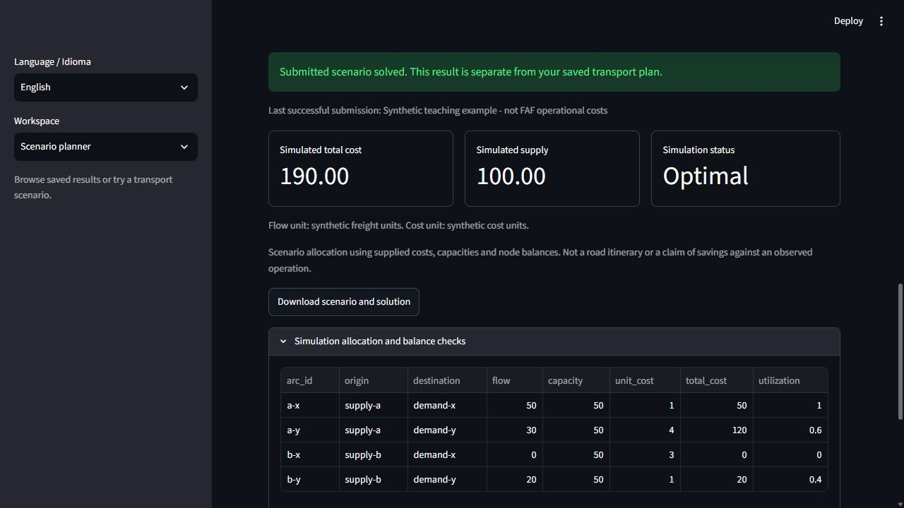
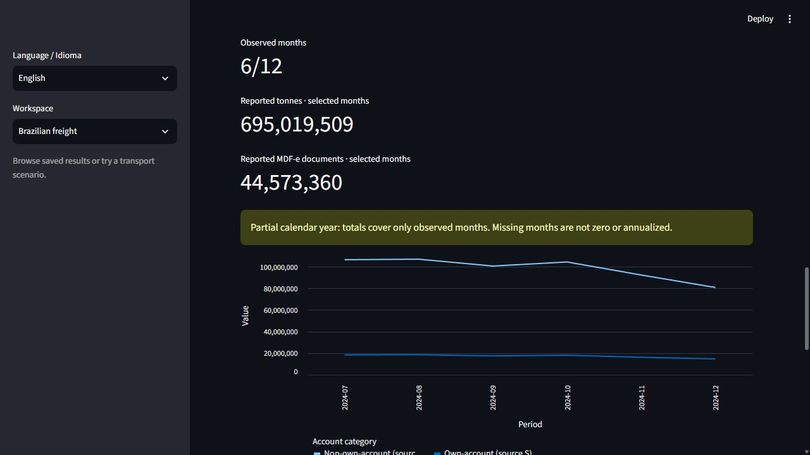
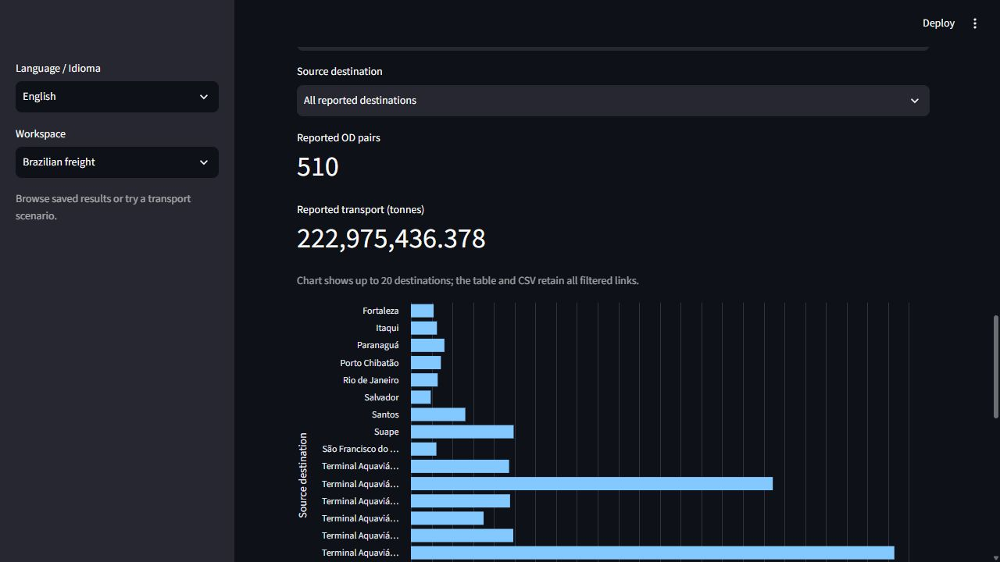
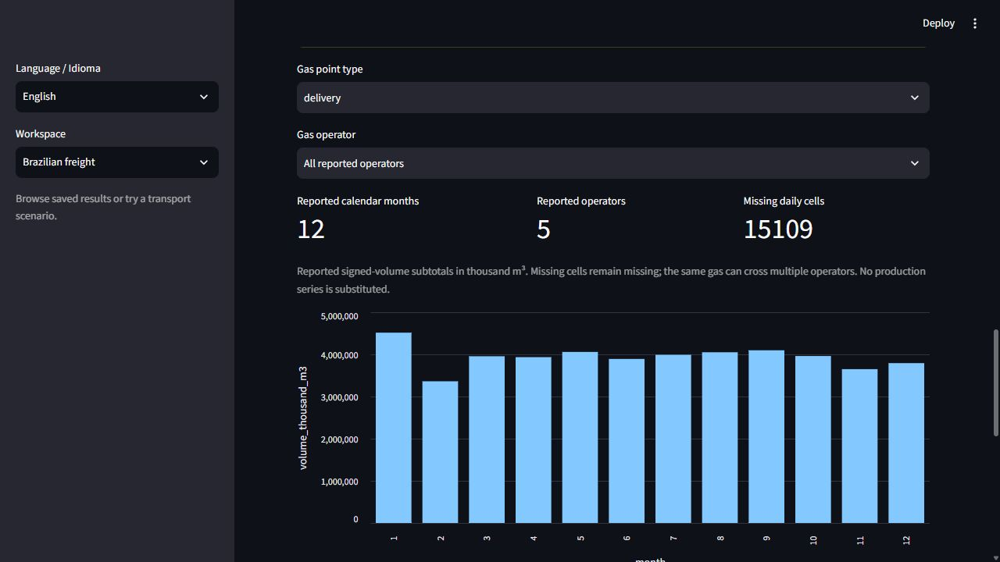
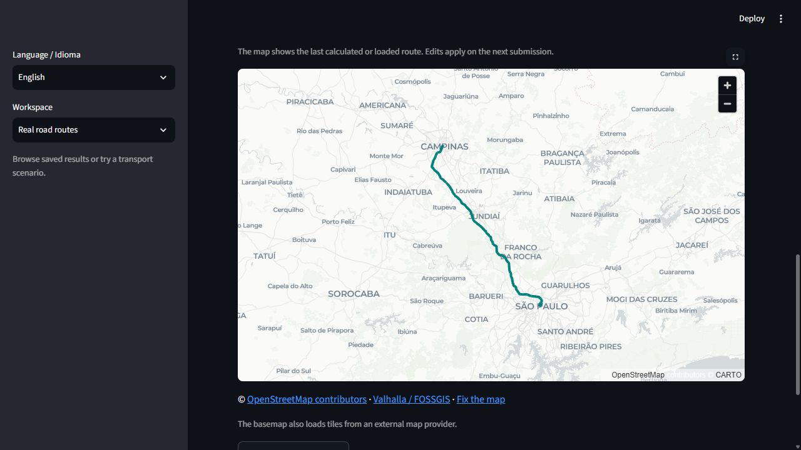
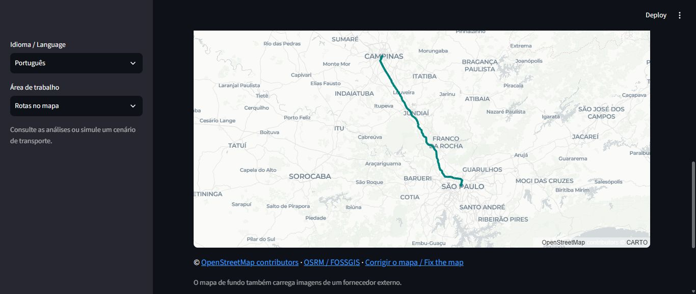
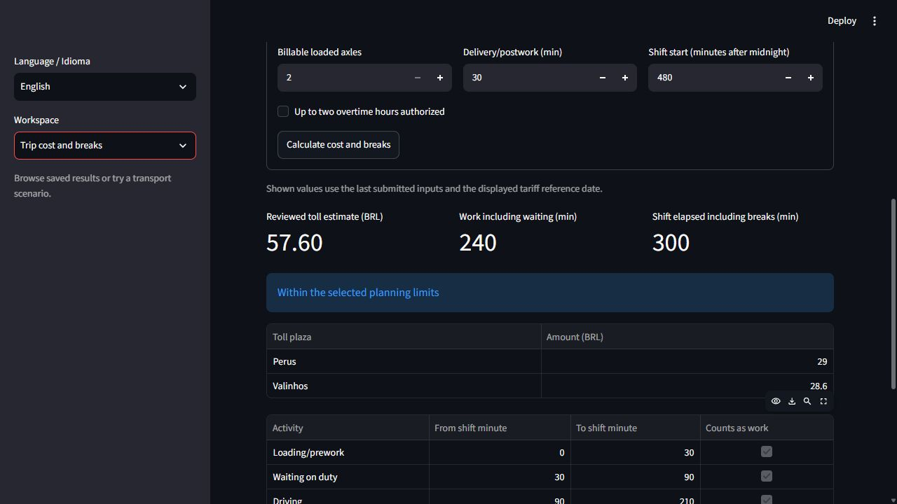
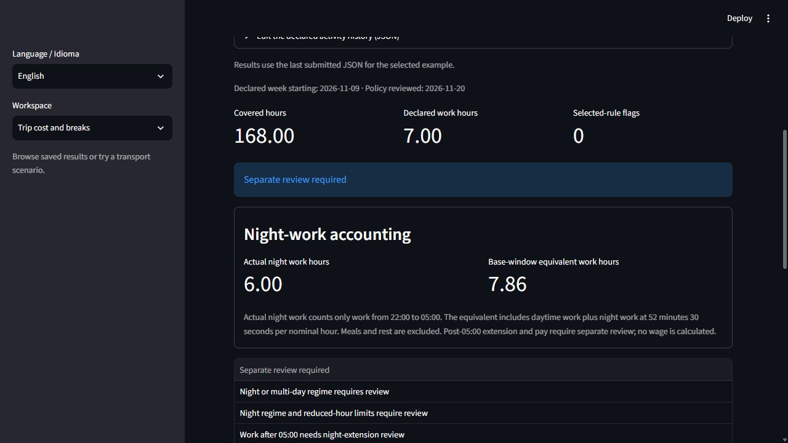
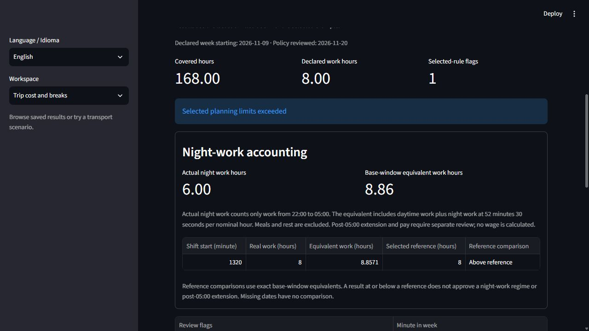
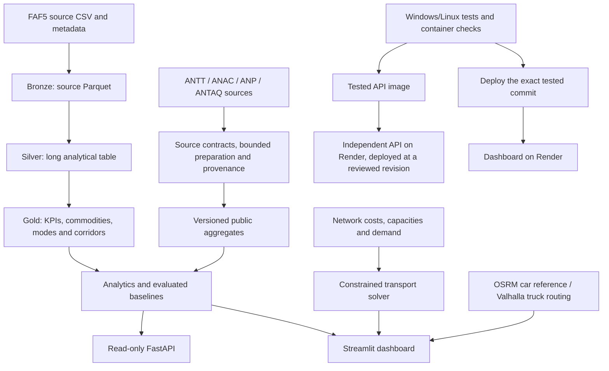

# LogiNexus: freight intelligence


Freight analytics for the United States and Brazil, built as one application: a 97.6-million-row
Medallion pipeline over the US Freight Analysis Framework, observed Brazilian rail, road, water,
air and pipeline histories, forecasts evaluated on years the models never saw, a constrained
transport optimizer, truck-aware routing, trip-cost and driver-hours planning, a dashboard and a
public API.

**[Open the live dashboard](https://loginexus-dashboard-preview.onrender.com/)** ·
[Public API](https://loginexus-public-api.onrender.com/docs) ·
[All results without opening a server](docs/portfolio_evidence.md) ·
[Complete project details](docs/project_details.md)

The dashboard and API run on Render's free plan, which sleeps after 15 minutes without traffic:
the first visit takes about 30 seconds to wake up. Everything below, the screenshots and the
static results page are on GitHub and do not depend on the servers.


## Results

| | |
|---|---|
| Pipeline scale | FAF5 CSV to **2,503,352 Bronze** and **97,630,728 Silver** rows, then analytical Gold tables, with streaming processing and per-file atomic writes |
| Railway forecast | **4.75% WAPE** (tonnes) and **1.61%** (tonne-km) on 2023-2025, held out from model selection, against 2006-2025 ANTT history |
| Honest losses | ANAC paid-cargo models lose to plain persistence on the held-out years; the page shows every competing score instead of re-selecting on the test |
| Road origin-destination | **775 state pairs** for 2025 that reconcile exactly, by origin and by destination, to **1,368,627,704 tonnes** |
| Cabotage | **510 port-to-port links** covering all 98 origins and 71 destinations in the 2025 source table |
| Hosting memory | A real out-of-memory crash on the 512 MiB host was traced and fixed; six concurrent sessions now peak at **249.5 MiB** |
| Quality | **708 tests** on Windows and Linux, container checks for the dashboard and the API, and deploys only of the exact commit that passed |

## What is inside

| Workspace | What it does |
|---|---|
| Freight analytics (US) | Annual KPIs, CAGR over irregular years, commodity mix, domestic modes, corridor concentration and leading corridors from FAF5 scenarios |
| Brazilian freight | Rail (ANTT, 2006-2025), road (28 observed months and 2025 state pairs), port handling and cabotage (ANTAQ), inland waterways, air cargo (ANAC, 55,559 monthly airport pairs) and gas pipelines (ANP), plus a 145-indicator five-mode atlas with units and sources kept separate |
| Forecast evaluation | Persistence, linear and CAGR baselines with expanding-window validation and a reserved test period for rail, air, port handling and Transpetro oil movements |
| Scenario planner | Minimum-cost allocation with capacities, supply and demand balance, transshipment and infeasibility detection; editable networks, JSON import and downloads |
| Truck routing | Valhalla truck routes that respect height, width, weight, axles and hazardous cargo, next to an OSRM car reference; map, turn-by-turn and GeoJSON |
| Trip cost and driver hours | Dated per-axle toll estimates for the SP-330/SP-348 corridor, driving and break timeline, seven-day duty review and exact night-work accounting |
| Read-only API | Indicators, histories, forecasts, quality diagnostics and saved allocations, with filters, pagination and optional API keys and user roles |

## Screenshots

Every workspace of the dashboard, captured from the application running on the versioned public data.

### Planning and optimization

**Transport scenario planner:** a solved synthetic network with the optimal allocation and supply/demand balance checks.



### Brazilian freight

**Railway:** ANTT history 2006-2025, monthly movements, commodities and the held-out forecast evaluation (shown with the optional Portuguese interface).


**Road history:** monthly ANTT road movements with partial years marked as partial.



**Road origin-destination, 2025:** 775 state pairs reconciling exactly to 1,368,627,704 tonnes; the chart shows the 20 largest.


**Port handling:** 62 monthly observations, January 2021 to February 2026.


**Cabotage origin-destination, 2025:** 510 port-to-port links reconciling to 222,975,436.378 tonnes.



**Regional cabotage:** links originating in Nordeste with the full-panel share kept.


**Inland waterways:** 62 monthly totals split into three navigation components.


**Inland cargo, 2025:** 117 source categories; unavailable quantities stay unavailable.


**Air cargo:** ANAC 2025 domestic monthly paid cargo with missing fields disclosed.


**Gas pipelines:** ANP delivery-point volumes by operator with missing daily cells counted.



### Routing, trip cost and driver hours

**Truck route:** Valhalla São Paulo-Campinas route for a declared truck profile.



**Car reference route:** the OSRM route used for comparison (Portuguese interface).



**Trip cost and breaks:** dated per-axle toll estimate and the work and break timeline.



**Seven-day duty review:** declared week with daily work and rest checks.


**Night shift:** night-work hours and the base-window equivalent.



**Reduced-hour reference:** a shift that exceeds the eight-hour reference with eight real work hours.



**Night extension:** work after 05:00 compared separately from the base result.


Each workspace's numbers, units and caveats are in the [project details](docs/project_details.md).

## Architecture



The hosted services read compact, hash-checked public snapshots; they never rebuild the
100-million-row pipeline on startup.

**Stack:** Python 3.13, Polars, Parquet/PyArrow, DuckDB, NumPy/SciPy, pandas, scikit-learn,
Streamlit, FastAPI, Docker, pytest, Ruff and GitHub Actions.

## Engineering decisions

- **Memory incident on a 512 MiB host.** Corridor loading is now bounded before collection and
  the solver import is deferred. A CI check replays the same load, six sessions and 18 renders,
  inside a 512 MiB container and fails above 420 MiB or on any out-of-memory kill.
  [Incident and fix](docs/memory_incident.md).
- **Writes that cannot leave a half-written table.** Every Gold and lookup output is written to a
  staging file and replaces the destination only after the writer succeeds.
- **Sources change without warning.** Scheduled audits re-download the ANP, ANTT and ANAC files and
  quarantine any revision for review instead of publishing it. [Audit policy](docs/source_refresh.md).
- **Units and populations stay apart.** Airport stages, pipeline transfers and port handling can
  count the same cargo more than once, so the atlas never adds them into a single modal share.
- **Missing stays missing.** Blank source cells are traced to their point and date and kept null;
  totals are reconciled against the source's own headline numbers.

## Run it

With Docker, the complete demo with the bundled public data:

```bash
docker build -f deployment/Dockerfile.dashboard -t loginexus-dashboard:local .
docker run --rm -p 127.0.0.1:8502:8501 loginexus-dashboard:local
```

Then open [http://127.0.0.1:8502/](http://127.0.0.1:8502/).

From source, with Python 3.13:

```bash
python -m pip install -e ".[app,dev]"
python -m pytest tests --ignore=tests/test_faf5.py -q
python -m streamlit run dashboards/app.py --server.address 127.0.0.1 --server.port 8501
```

The full pipeline needs `FAF5.5.1_HiLoForecasts.csv` and `FAF5_metadata.xlsx` (US Bureau of
Transportation Statistics / Oak Ridge National Laboratory) in `data/raw/faf5/forecast/`, then
`python -m freight_intelligence.pipeline`. It processes about 100 million rows; a
[manual workflow](.github/workflows/howto-check.yml) runs these steps end to end with the real file.
More commands, API examples and the recovery package are in the [project details](docs/project_details.md#reproduce-individual-components).

## Limits

- The optimization examples use synthetic demand and costs: the savings they show are model
  results, not measured savings at a real carrier.
- Truck routes use mapped restrictions; they do not certify current road conditions for dispatch.
- The toll and driver-hours tools cover one corridor and selected rules on a reviewed date; they
  plan and flag, and they do not certify legal compliance.
- FAF future years are scenarios, not observations.
- Running this for a real company would need its own data and sign-off: vehicles and regions,
  employment terms and driver records, an availability target, and realized outcomes to compare
  against. Those steps are tracked in the [delivery checklist](docs/expansion_execution.md).

Data from the US Freight Analysis Framework and Brazilian public sources (ANTT, ANTAQ, ANAC, ANP);
each source, unit and download is documented in [docs](docs/).
