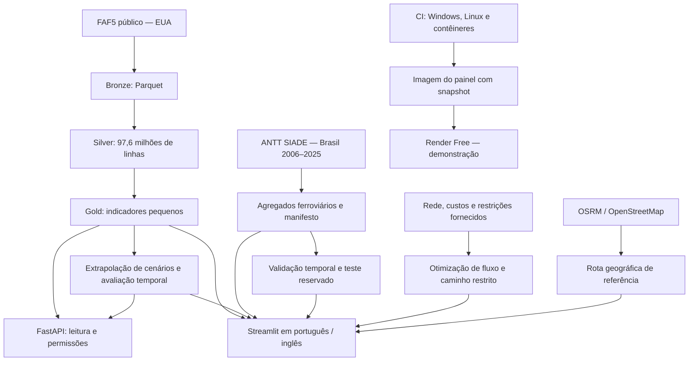

# Arquitetura e decisões

## Separações importantes

O processamento volumoso é local e explícito. A aplicação publicada contém apenas
agregados pequenos, modelos/resultados de referência e exemplos públicos. Abrir o
painel não inicia ingestão nem refaz o pipeline. As novas rotas só consultam o serviço
externo mediante submissão explícita; o exemplo salvo funciona sem esse serviço.

As séries FAF e ANTT têm coberturas e unidades diferentes e não são concatenadas.
No FAF, os anos de cenário continuam identificados como projeções. No ANTT, a série
é de movimentações administrativas declaradas e pode ser revisada. Os três baselines
são escolhidos somente na validação, com teste temporal final reservado.

Simulações de oferta/demanda usam programação linear de fluxo contínuo, com capacidade
e conservação de fluxo. O caminho sobre rede fornecida respeita as restrições
informadas. A rota geográfica externa usa perfil de automóvel e não transfere essa
garantia para caminhões. São resultados distintos apresentados em áreas separadas.

## Reprodutibilidade e publicação

Imagens usam Python por digest e dependências fixadas. O teste do painel roda com
512 MiB, usuário sem privilégios, sistema de arquivos somente leitura e sem rede,
conferindo hashes e os principais fluxos da aplicação. As consultas externas são
testadas por contratos e por uma consulta real identificada, sem chamar serviços
públicos repetidamente no CI.

Os arquivos de recuperação incluem código e dados derivados de uma revisão Git,
com hashes e instruções. Não incluem segredos, uploads de sessão ou a imagem Docker
completa. O armazenamento de sessão é temporário. Hospedagem gratuita tem limites
e não constitui uma promessa de disponibilidade permanente.
