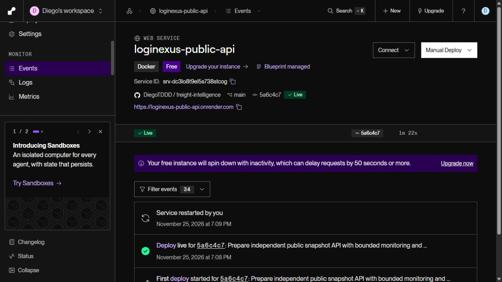

# Independent public snapshot API — X03

## Delivery boundaries

The separate API image runs Uvicorn/FastAPI without importing or starting
Streamlit. It reads the same reviewed public snapshots as the dashboard mount,
with no local private-plan fallback, uploads, training or heavy pipeline run.
The original local/private API image and required-auth deployment remain separate.
Optional key/user authentication still works on this public image if configured.

**X03 remains open** until its full availability acceptance is demonstrated.
Separate hosting on a free plan is not a production uptime contract.

Implementation checkpoint **X03-T01**: separate public-snapshot entry point,
pinned API runtime, non-root/read-only container checks, metadata and public/private
boundary tests. T02 and T03 evidence is recorded below; T04 remains open.

## Observed deployment

On **2026-11-25** the independent API was deployed at
**https://loginexus-public-api.onrender.com**, documentation at `/docs`.
Render service `srv-dc3lo8t9el5s738stcog` is **Free** and Blueprint-managed from
`deployment/render.public-api.yaml`; the dashboard remains on its original service.
The tested deployed revision is **5a6c4c74cf7474a5bbcf3d3f1c62944ff695342e**,
with [all five CI checks and 666 tests on both Windows and Linux](https://github.com/DiegoTDDD/freight-intelligence/actions/runs/45709980650).
The public image also passed real HTTP/data/private-plan checks offline within 512 MiB.

The [first manual monitor run](https://github.com/DiegoTDDD/freight-intelligence/actions/runs/45710738433)
passed. Its schedule is **09:17 UTC daily (06:17 Sao Paulo)**; GitHub may delay
scheduled jobs. No scheduled execution or uptime history is claimed before it occurs.
The bounded probe passed before and after a **planned service restart**, retaining
the revision and public snapshot-manifest hash. Twenty analytical/duty responses
matched the legacy dashboard API exactly after the restart. This is one restart
exercise, not a catastrophic-outage or provider-independence demonstration.

The measured probe totals were about 1.20 seconds initially and 1.04 seconds after
the restart; the first GitHub sample was about 0.76 seconds. These were warm
observations. Idle cold-start duration and a statistical availability percentage
were not measured. The monitor's 180-second identity and 10-second sampled-response
budgets are explicit demo targets, not production guarantees.

[Machine-readable evidence](evidence/independent_api_delivery_20261125.json) includes
the deployment identifiers, reports and parity hashes. The UI capture shows the
Free plan, live revision and recorded restart:



## Reproduce the independent service

```bash
docker build -f deployment/Dockerfile.public-api -t loginexus-public-api:local .
docker run --rm --read-only --tmpfs /tmp --memory 512m -p 127.0.0.1:8001:8000 loginexus-public-api:local
```

Open `/docs` on port 8001. The independent API has no `/api` prefix. The existing
dashboard mount retains `/api` for backward compatibility. The two entry points
share code and source versions, not a hosting process. The dashboard does not
depend on the separate API being awake.

`/health` checks process liveness; `/ready` checks the reviewed annual dataset.
`/version` reports the service identity, a validated 40-character revision from
Render's runtime `RENDER_GIT_COMMIT` (or a local `LOGINEXUS_BUILD_REVISION`) and the
public snapshot-manifest SHA-256. Unknown revision values are reported as unknown,
never replaced with an invented revision. Other environment variables are not exposed.
Reader endpoints retain their existing hash/schema checks. `/transport-plan`
must return 503 when the public snapshot has no private business plan.

## Hosting and updates

[The dedicated Blueprint](../deployment/render.public-api.yaml) describes a
**Free** Docker web service with `/ready` health checks. For the existing public
Git source, deployments are triggered manually at a revision that passed CI;
automatic deployment is off. This avoids depending on an unconfigured Git-provider
integration. It creates no database, disk,
custom domain, payment method or API credential. All intended snapshot data are
already public. This is a separate service, not a claim of provider independence.

Render's [free-plan policy](https://render.com/docs/free) provides 750 running
instance-hours **shared by the workspace**, not 750 hours per service. Two services
can exhaust that shared amount sooner. Free services sleep after inactivity,
lose local filesystem changes on restart/redeploy and have no production SLA.
No synthetic keepalive or paid upgrade is part of this delivery.

## Bounded monitoring target

Run `scripts/probe_public_api.py --base-url https://HOST --output report.json`.
Use `--expected-revision` for an exact tested/deployed-commit acceptance check.
The probe permits up to **180 seconds** for the on-demand service identity to
appear, then checks sampled readiness, one annual KPI and the unavailable private
plan boundary with a **10-second budget per response**. It rejects redirects,
wrong service/revision, snapshot drift and accidental private-plan exposure. Reports
include observations and errors and the command fails when service checks fail.
This is sampled demo-service acceptance, not a measured uptime percentage or SLA.

The [monitor workflow](../.github/workflows/probe-public-api.yml) uses the public
repository variable `LOGINEXUS_PUBLIC_API_URL`. It preserves each run's report
for 14 days. Scheduling is enabled only after the actual deployed URL is verified;
monitoring must not be used to keep the free instance continuously awake. The daily
schedule is now configured for the observed service URL.
Service-monitor failures are separate from ANP/ANTT **source** unavailability:
their bounded retries and `source_unreachable` warning behavior remain unchanged.

## Recovery procedure

1. Identify the last revision with successful required CI and a matching `/version`.
2. Redeploy that revision from Render's service controls, or recreate the Free
   service from the versioned Dockerfile/Blueprint and verified recovery archive.
3. Check `/ready`, `/version`, snapshot hash and the bounded probe, including
   `/transport-plan` returning 503. Keep the evidence report.
4. Update the public URL/monitor configuration only if the service URL changed.

The immutable bundled snapshots require no database restore. A documented
procedure alone is not recovery evidence; the planned restart described above
is the observed exercise for this delivery.
